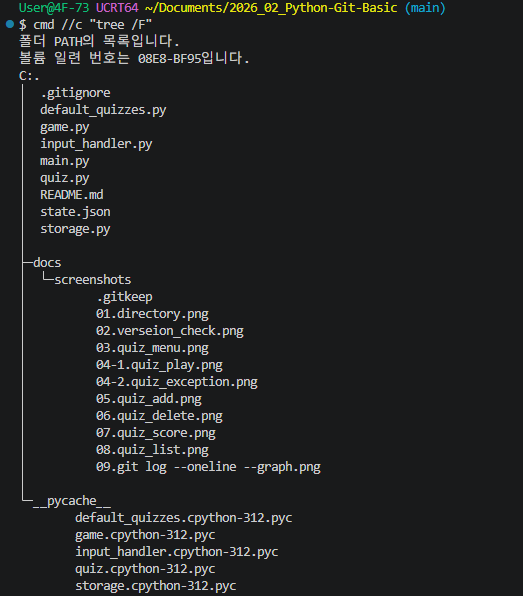
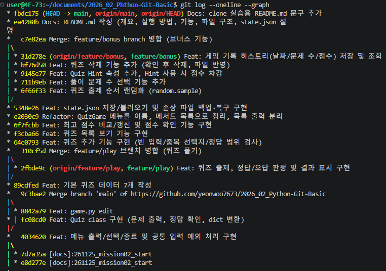
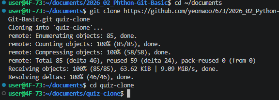
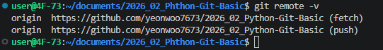
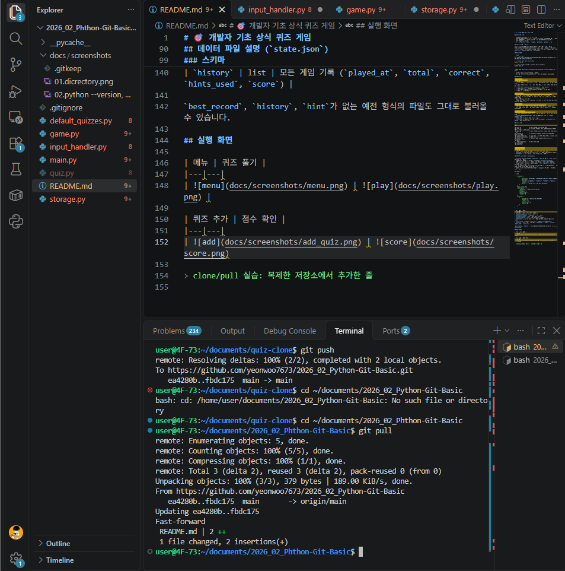
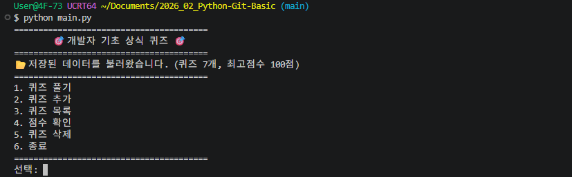
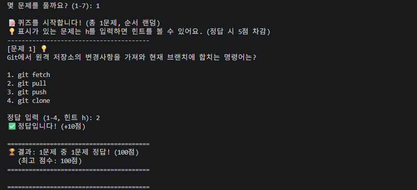
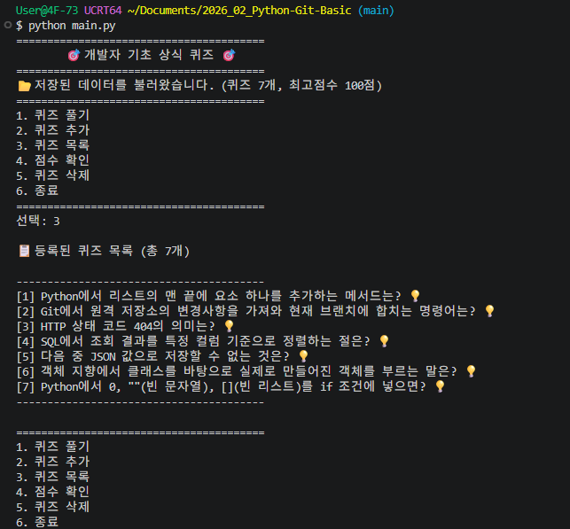

# 🎯 개발자 기초 상식 퀴즈 게임

## 프로젝트 개요

터미널에서 실행하는 객관식 퀴즈 게임입니다.
Python 기본 문법과 표준 라이브러리만 사용했고, 클래스로 역할을 나눠 구성했습니다.
퀴즈와 점수 기록은 `state.json`에 저장되어, 프로그램을 껐다 켜도 그대로 유지됩니다.

- 언어: Python 3.10 이상 (외부 라이브러리 없음)
- 사용한 표준 라이브러리: `json`, `random`, `datetime`, `pathlib`, `os`, `time`, `logging`
- **기본 퀴즈: 7개** (`default_quizzes.py`) — 바꾸려면 [기본 퀴즈 바꾸기](#기본-퀴즈-바꾸기) 참고
- **커밋: 25개** (병합 커밋 4개 포함, 이 README 작성 시점 기준) — 최신 값은 `git rev-list --count HEAD`로 확인

## 퀴즈 주제와 선정 이유

**주제: 개발자 기초 상식 (Python · Git · 웹 · DB · 객체 지향)**

> 이번 과정에서 배우는 Python과 Git, 그리고 실무에서 매일 쓰는 HTTP·SQL·JSON 같은 기초 개념을 문제로 만들어 스스로 점검하고 싶었습니다. 문제를 직접 만들면서 "정확히 설명할 수 있는가"를 확인할 수 있었고, 힌트를 쓰면서 개념을 한 줄로 요약하는 연습도 되었습니다.

## 실행 방법

```bash
# 1. 저장소 복제
git clone https://github.com/yeonwoo7673/2026_02_Python-Git-Basic.git
cd 2026_02_Python-Git-Basic

# 2. Git 버전 확인
User@4F-73 UCRT64 ~/Documents/2026_02_Python-Git-Basic (main)
$ git --version
git version 2.56.1.windows.1

# 3. Python 버전 확인 (3.10 이상)
User@4F-73 UCRT64 ~/Documents/2026_02_Python-Git-Basic (main)
$ python --version
Python 3.12.10

# 4. 실행 (macOS/Linux에서 python이 없으면 python3)
User@4F-73 UCRT64 ~/Documents/2026_02_Python-Git-Basic (main)
$ python main.py
========================================
        🎯 개발자 기초 상식 퀴즈 🎯
========================================
📂 저장된 데이터를 불러왔습니다. (퀴즈 7개, 최고점수 100점)
========================================
1. 퀴즈 풀기
2. 퀴즈 추가
3. 퀴즈 목록
4. 점수 확인
5. 퀴즈 삭제
6. 종료
========================================
💬 번호(1-6)를 입력하고 Enter. 언제든 Ctrl+C로 저장 후 종료할 수 있어요.
```


- 메뉴에서 번호를 입력해 기능을 고릅니다. 메뉴 아래 도움말 한 줄이 항상 표시됩니다.
- 실행 중 `Ctrl+C`를 눌러도 데이터를 저장한 뒤 안전하게 종료됩니다.

### 디버그 로그 켜기 (선택)

```bash
QUIZ_DEBUG=1 python main.py          # Git Bash / macOS / Linux
$env:QUIZ_DEBUG=1; python main.py    # PowerShell
```

프로젝트 루트에 `quiz.log`가 생기고, 입력 검증 실패·저장 재시도·백업 기록이 남습니다. (`.gitignore` 대상)

```text
2026-11-27 14:10:02,118 [INFO] quiz.input | 입력 검증 실패 | 입력='abc' | 이유=숫자가 아닙니다. 1-6 사이의 숫자를 입력하세요.
```

### 직접 테스트해 보기

| 시나리오 | 방법 | 기대 결과 |
|---|---|---|
| 첫 실행 | `state.json` 없이 실행 | "📂 저장된 데이터가 없어 기본 퀴즈로 시작합니다." + `state.json` 생성 |
| 저장 유지 | 퀴즈 1개 추가 + 한 판 풀고 종료 → 재실행 | "📂 저장된 데이터를 불러왔습니다. (퀴즈 8개, 최고점수 ○점)" |
| 한글 저장 | `cat state.json` | 한글이 `\uXXXX`가 아닌 글자 그대로 보임 (UTF-8) |
| 손상 복구 | `echo broken > state.json` 후 실행 | "⚠️ 데이터 파일이 손상되었습니다 … 복구했습니다" + 백업 파일 생성 |
| Git 제외 | `git status` | `state.json`, 백업, `quiz.log`가 목록에 안 보임 |

테스트 후 정리: `rm -f state.corrupted-*.json`

## 기능 목록

### 기본 기능

| 메뉴 | 기능 | 설명 |
|---|---|---|
| 1 | 퀴즈 풀기 | 저장된 퀴즈를 출제하고 정답/오답을 알려준 뒤 결과(점수)를 표시 |
| 2 | 퀴즈 추가 | 문제, 선택지 4개, 정답 번호, (선택) 힌트를 입력받아 등록 후 저장 |
| 3 | 퀴즈 목록 | 등록된 퀴즈 목록 출력 (💡 = 힌트 있음) |
| 4 | 점수 확인 | 최고 점수와 최근 게임 기록 출력 |
| 5 | 퀴즈 삭제 | 번호로 골라 확인(y/n) 후 삭제, 파일에 반영 |
| 6 | 종료 | 저장 후 종료 |

### 보너스 기능

- **랜덤 출제**: `random.sample()`로 매번 문제 순서를 섞어 출제
- **문제 수 선택**: 풀기 전에 1~(전체 개수) 중 몇 문제를 풀지 선택
- **힌트**: 💡 표시 문제에서 `h` 입력 시 힌트 표시. 힌트를 보고 맞히면 10점 → 5점
- **퀴즈 삭제**: 메뉴 5번
- **점수 기록 히스토리**: 게임마다 날짜/시간, 푼 문제 수, 정답 수, 힌트 사용 수, 점수를 저장

### 점수 계산

- 문제당 10점, 힌트를 사용하고 맞히면 5점, 틀리면 0점
- 최종 점수 = 얻은 점수 ÷ (문제 수 × 10) × 100 (반올림, 100점 만점)
- 문제 수가 달라도 비교할 수 있도록 100점 만점으로 환산해 최고 점수와 비교합니다.

### 입력/예외 처리

- 입력 앞뒤 공백 제거 (` 1 ` → `1`)
- 빈 입력, 숫자가 아닌 입력(`abc`), 범위 밖 숫자(`9`, `0`)는 안내 후 다시 입력
- 모든 입력 오류 안내는 `⚠️ [입력 오류] 이유` 한 가지 형식으로 통일 (`input_handler.report_input_error`)
- `Ctrl+C`(KeyboardInterrupt), 입력 끝(EOFError) 발생 시 저장 후 안전하게 종료
- `state.json`이 없으면 기본 퀴즈로 시작
- `state.json`이 손상되면 안내 후 `state.corrupted-날짜시간.json`으로 백업하고 기본 데이터로 복구

### 저장 실패 시 복구 안내

저장은 실패하면 **0.3초 뒤 1번 더 시도**합니다. 그래도 실패하면 아래처럼 항상 같은 형식으로 안내합니다.

```text
⚠️ [저장 오류] 데이터를 저장하지 못했습니다: [Errno 13] Permission denied: '.../state.json.tmp'
   📁 저장 위치: C:\Users\User\Documents\2026_02_Python-Git-Basic\state.json
   👉 파일이 편집기·백신·클라우드 동기화 프로그램에서 열려 있는지, 폴더에 쓰기 권한이 있는지 확인하세요.
   👉 지금 기록을 따로 지키려면: cp "…/state.json" "…/state.json.bak"   (Windows CMD: copy)
```

- 퀴즈 추가·삭제 직후 저장에 실패해도 메모리에는 반영되어 있으므로, 종료할 때 한 번 더 저장을 시도합니다.
- 임시 파일에 먼저 쓰고 교체하는 방식이라, 저장에 실패해도 **기존 `state.json`은 깨지지 않습니다.**

## 파일 구조

```text
.
├── main.py              # 실행 진입점, Ctrl+C/EOF 처리, 디버그 로그 설정
├── game.py              # QuizGame 클래스: 메뉴, 풀기/추가/목록/점수/삭제, 저장·불러오기 흐름
├── quiz.py              # Quiz 클래스: 문제 1개 (출력, 정답 확인, dict 변환)
├── storage.py           # StateStore 클래스: state.json 읽기/쓰기, 재시도, 손상 파일 백업·정리
├── input_handler.py     # 공통 입력 검증 함수 (숫자 범위, 빈 입력, y/n), 입력 오류 안내 형식
├── default_quizzes.py   # 기본 퀴즈 7개
├── state.json           # 실행 시 자동 생성되는 데이터 파일 (.gitignore로 제외)
├── docs/
│   └── screenshots/                 # 실행 화면 캡처
│       ├── .gitkeep
│       ├── 01.directory.png         # 파일 구조
│       ├── 02.version_check.png     # Git·Python 버전 확인 및 실행
│       ├── 03.quiz_menu.png         # 메뉴 화면
│       ├── 04-1.quiz_play.png       # 퀴즈 풀기
│       ├── 04-2.quiz_exception.png  # 잘못된 입력 처리
│       ├── 05.quiz_add.png          # 퀴즈 추가
│       ├── 06.quiz_delete.png       # 퀴즈 삭제
│       ├── 07.quiz_score.png        # 점수 확인
│       ├── 08.quiz_list.png         # 퀴즈 목록
│       └── 09.git_log.png           # Git 커밋 기록
├── .gitignore
└── README.md
```

> `__pycache__/`는 Python이 실행할 때 자동으로 만드는 캐시 폴더라서 `.gitignore`로 제외했습니다.



### 클래스별 역할

| 클래스 | 책임 |
|---|---|
| `Quiz` | 퀴즈 1개의 데이터와 검증, 화면 출력, 정답 확인 |
| `QuizGame` | 게임 전체 상태(퀴즈 목록, 최고 점수, 기록)와 메뉴 흐름 |
| `StateStore` | 파일 입출력만 담당 (게임 로직은 모름) |

### 로직 분리 원칙

> **입력 검증은 UI 경계, 데이터 입출력은 영속성 경계, 그 사이의 규칙은 게임 로직.**

| 경계 | 담당 | 이 경계가 아는 것 / 모르는 것 |
|---|---|---|
| UI 경계 | `input_handler.py` | 사람이 친 문자열을 "믿을 수 있는 값"으로 바꿈. 점수·파일은 모름 |
| 게임 로직 | `QuizGame`, `Quiz` | 점수 계산, 최고 점수 갱신, 언제 저장할지. 파일 형식·경로는 모름 |
| 영속성 경계 | `StateStore` | dict를 JSON으로 읽고 씀, 재시도·백업. 퀴즈·점수의 의미는 모름 |

### 책임이 애매할 때 어디로 옮길까?

| 상황 | 지금 위치 | 옮길 곳 | 이유 |
|---|---|---|---|
| 점수 정책이 복잡해짐 (난이도별 배점, 연속 정답 보너스) | `QuizGame.play()` 안의 계산식 | 새 `ScorePolicy` 클래스 | 게임 흐름과 점수 규칙을 따로 바꾸고 테스트할 수 있음 |
| 로그를 파일 말고 서버로 보내야 함 | 각 모듈의 `logging` 호출 | `main.setup_logging()`의 핸들러만 교체 | 로그를 "남기는 쪽"은 그대로 두고 "보내는 곳"만 바꿈 |
| 저장소를 JSON → DB로 바꿈 | `StateStore` | 같은 `load()`/`save()`를 가진 `DbStateStore` | `QuizGame`은 저장 방식을 모르므로 코드 수정이 거의 없음 |
| 문제 출력 화면을 GUI로 바꿈 | `Quiz.display()` | 화면 담당 클래스(View) | `Quiz`는 데이터·정답 확인만, 그리는 일은 화면 쪽에서 |

### 왜 함수가 아니라 클래스를 썼나

함수만으로도 같은 게임을 만들 수 있지만, 그러면 `quizzes`, `best_score`, `history` 같은 상태를 **전역 변수로 두거나 모든 함수에 인자로 계속 넘겨야** 합니다.

| 비교 | 함수만 사용 | 클래스 사용 (현재) |
|---|---|---|
| 상태 보관 | 전역 변수 또는 매번 인자로 전달 | `self.quizzes`처럼 객체가 직접 보관 |
| 데이터 검증 | 퀴즈 dict를 쓰는 곳마다 형식 확인 필요 | `Quiz.__init__`에서 한 번만 검증 → 만들어진 `Quiz`는 항상 올바름 |
| 관련 기능 묶기 | `display_quiz(q)`, `check_answer(q, a)`가 흩어짐 | `quiz.display()`, `quiz.is_correct()`로 데이터와 동작이 함께 있음 |
| 교체·테스트 | 파일 경로가 함수 안에 박혀 바꾸기 어려움 | `QuizGame(StateStore(경로))`처럼 저장소를 넣어 주므로 테스트용 경로로 쉽게 교체 |

정리하면 **`Quiz`는 "올바른 퀴즈 1개"라는 약속을 지키기 위해**, **`QuizGame`은 흩어질 상태를 한곳에 모으기 위해**, **`StateStore`는 저장 방식을 갈아 끼울 수 있게 하기 위해** 클래스로 만들었습니다.

## 데이터 파일 설명 (`state.json`)

- **경로**: 프로젝트 루트의 `state.json` (`main.py`와 같은 폴더, 어디서 실행해도 같은 위치)
- **인코딩**: UTF-8 (한글이 그대로 보이도록 `ensure_ascii=False`)
- **역할**: 퀴즈 목록, 최고 점수, 게임 기록을 저장해 재실행 후에도 유지
- **생성 시점**: 첫 실행 시 자동 생성되고, 퀴즈 추가/삭제, 게임 종료, 프로그램 종료 때마다 저장
- **저장 방식**: 임시 파일(`state.json.tmp`)에 먼저 쓴 뒤 교체하여, 저장 도중 문제가 생겨도 기존 파일이 깨지지 않음
- **Git 관리**: 개인 플레이 기록이므로 `.gitignore`에 넣어 저장소에는 올리지 않음

### 읽기 / 쓰기 순서

```text
[읽기] 실행 → state.json 있음? ─ 없음 → 기본 퀴즈 7개로 시작 → 바로 저장
                    │
                    └ 있음 → JSON 읽기 → 구조 검증(퀴즈·점수·기록) → 전부 통과하면 한 번에 반영
                                 └ 실패 → state.corrupted-날짜시간.json 백업 → 기본 데이터로 복구

[쓰기] 상태를 dict로 변환 → state.json.tmp에 쓰기 → os.replace로 state.json 교체
                                 └ 실패 → 0.3초 뒤 1회 재시도 → 그래도 실패면 복구 안내 출력
```

검증을 **전부 통과한 뒤에 한 번에 반영**하기 때문에, 중간에 오류가 나도 반쯤 불러온 상태가 생기지 않습니다.

### 스키마

```json
{
    "quizzes": [
        {
            "question": "Python에서 리스트의 맨 끝에 요소 하나를 추가하는 메서드는?",
            "choices": ["append()", "insert()", "extend()", "add()"],
            "answer": 1,
            "hint": "'덧붙이다'라는 뜻의 영어 단어예요."
        }
    ],
    "best_score": 80,
    "best_record": {
        "played_at": "2026-11-25 19:40:00",
        "total": 5,
        "correct": 4,
        "hints_used": 0,
        "score": 80
    },
    "history": [
        {
            "played_at": "2026-11-25 19:40:00",
            "total": 5,
            "correct": 4,
            "hints_used": 0,
            "score": 80
        }
    ]
}
```

| 키 | 타입 | 설명 |
|---|---|---|
| `quizzes` | list | 퀴즈 목록 (필수) |
| `quizzes[].question` | str | 문제 |
| `quizzes[].choices` | list[str] | 선택지 4개 |
| `quizzes[].answer` | int | 정답 번호 (1~4) |
| `quizzes[].hint` | str | 힌트 (없으면 빈 문자열) |
| `best_score` | int \| null | 최고 점수 (0~100), 아직 안 풀었으면 `null` |
| `best_record` | object \| null | 최고 점수를 낸 게임의 기록 |
| `history` | list | 모든 게임 기록 (`played_at`, `total`, `correct`, `hints_used`, `score`) |

`best_record`, `history`, `hint`가 없는 예전 형식의 파일도 그대로 불러올 수 있습니다.

### 왜 중첩 구조로 만들었나

- **같은 모양의 기록을 재사용**: `best_record`와 `history[]`의 원소는 똑같은 "게임 기록" 형태입니다. 그래서 검증 함수 하나(`_is_valid_record`)로 둘 다 확인하고, 최고 점수를 내면 방금 만든 기록 dict를 그대로 `best_record`에 넣습니다.
- **퀴즈 1개 = 객체 1개**: `quizzes[]`의 원소가 `Quiz.to_dict()` / `Quiz.from_dict()`와 1:1로 대응해서, 파일 ↔ 객체 변환이 한 줄로 끝납니다.
- **필드 추가가 쉬움**: 예를 들어 퀴즈에 `category`를 넣고 싶으면 퀴즈 객체 안에 키 하나만 추가하면 되고, 다른 최상위 키에는 영향이 없습니다.

### 왜 JSON인가, 그리고 한계

| | JSON 파일 (현재) | DB (SQLite 등) |
|---|---|---|
| 장점 | 표준 라이브러리만으로 가능, 사람이 바로 열어 읽고 고칠 수 있음, 구조(목록·객체)를 그대로 표현 | 일부만 읽고 쓰기, 검색·정렬, 동시 접근 제어(트랜잭션) |
| 단점 | 저장할 때마다 **파일 전체를 다시 씀**, 불러올 때 **전체를 메모리에 올림** | 설치·스키마 설계 필요, 파일을 직접 열어 보기 어려움 |
| 적합한 규모 | 퀴즈 수백 개, 기록 수천 건 수준의 개인용 | 데이터가 계속 쌓이거나 여러 명이 함께 쓰는 경우 |

> ⚠️ **한계 경고**: `history`는 게임할 때마다 계속 늘어나고, 저장할 때마다 파일 전체를 다시 쓰므로 기록이 아주 많아지면 저장이 느려지고 메모리를 더 씁니다. 데이터가 커지면 **기록은 최근 N개만 보관**하거나 **SQLite(DB)로 전환**을 고려합니다. `StateStore`만 바꾸면 되도록 분리해 두었습니다.

### 동시 실행 주의

이 게임은 **한 번에 하나만 실행**하는 것을 전제로 합니다. 파일 잠금(lock)이 없으므로 터미널 두 개에서 동시에 실행하면 **나중에 저장한 쪽이 앞의 기록을 덮어씁니다.** (파일이 깨지지는 않지만 한쪽 기록이 사라질 수 있음)

### 손상 백업 보존·정리 정책

- 손상된 파일은 `state.corrupted-YYYYMMDD-HHMMSS.json` 이름으로 프로젝트 루트에 백업됩니다.
- 백업은 **최근 5개만 보관**하고, 새 백업이 생길 때 오래된 것부터 자동으로 지웁니다. (`storage.BACKUP_KEEP`)
- 백업 파일은 `.gitignore` 대상이라 저장소에 올라가지 않습니다. 확인이 끝났으면 직접 지워도 됩니다.

### 오류 처리 · 재시도 · 로그 정책

| 상황 | 처리 |
|---|---|
| 파일 없음 | 기본 퀴즈로 시작하고 새로 저장 |
| JSON 문법 오류, UTF-8 아님, 구조 오류 | 손상으로 보고 백업 후 기본 데이터로 복구 |
| 읽기 권한 없음 등 (내용은 멀쩡할 수 있음) | 원본을 덮어쓰지 않도록 이번 실행에서는 저장하지 않고 기본 데이터로 실행 |
| 저장 실패 (`OSError`) | 0.3초 뒤 1회 재시도 (`storage.SAVE_RETRIES`) → 그래도 실패면 복구 안내 출력 |
| 로그 | 평소엔 남기지 않음. `QUIZ_DEBUG=1`일 때 `quiz.log`에 입력 오류·저장 실패·백업 기록 |

## 요구사항 변경 시 수정 체크리스트

| 바꾸고 싶은 것 | 수정할 파일 | 관련 위치 | 함께 확인할 것 |
|---|---|---|---|
| 문제당 배점, 힌트 차감 점수 | `game.py` | `POINTS_PER_QUESTION`, `HINT_PENALTY` | README 점수 계산 설명 |
| 점수 확인 화면의 최근 기록 수 | `game.py` | `HISTORY_PREVIEW` | — |
| 기본 퀴즈 내용·개수 | `default_quizzes.py` | `get_default_quizzes()` | 기존 `state.json`이 있으면 반영 안 됨 → 아래 참고 |
| 선택지 개수 (4 → 5개) | `quiz.py` | `Quiz.CHOICE_COUNT` | `default_quizzes.py`의 모든 퀴즈 선택지, 기존 `state.json`(검증 실패 → 백업됨), README 스키마 |
| 메뉴 추가·순서 변경 | `game.py` | `QuizGame.__init__`의 `self.menu`, 새 핸들러 메서드 | README 기능 표 |
| 저장 항목 추가 (예: 플레이어 이름) | `game.py` | `_to_state()`, `_apply_state()` (예전 파일 대비 `data.get(키, 기본값)`) | README 스키마 표 |
| 저장 위치 | `main.py` | `STATE_PATH` | `.gitignore` |
| 저장 방식 (JSON → DB) | `storage.py` | `StateStore` (같은 `load()`/`save()` 유지) | `main.py`에서 생성하는 클래스 |
| 저장 재시도 횟수, 백업 보존 개수 | `storage.py` | `SAVE_RETRIES`, `SAVE_RETRY_DELAY`, `BACKUP_KEEP` | README 정책 표 |
| 입력 규칙 (예: y/n에 `ㅇ` 허용) | `input_handler.py` | `read_yes_no()` 등 | — |
| 입력 오류 안내 문구 형식 | `input_handler.py` | `report_input_error()` | — |

### 기본 퀴즈 바꾸기

1. `default_quizzes.py`의 `get_default_quizzes()` 목록에 `Quiz(문제, [선택지 4개], 정답번호, 힌트)`를 추가·수정·삭제합니다.
2. 기본 퀴즈는 **`state.json`이 없거나 손상됐을 때만** 쓰입니다. 바뀐 내용으로 다시 시작하려면 `state.json`을 지우고 실행하세요. (기존 기록도 함께 사라짐)
3. 기존 기록을 지키면서 추가하고 싶다면 메뉴 `2. 퀴즈 추가`를 사용합니다.

## Git 브랜치 전략과 커밋 규칙

### 브랜치 역할

| 브랜치 | 역할 |
|---|---|
| `main` | 항상 실행 가능한 완성본. 직접 개발하지 않고 기능 브랜치를 병합해서만 바꿈 |
| `feature/play` | 퀴즈 풀기(출제·정답 판정·결과 표시) 개발 |
| `feature/bonus` | 보너스 기능(랜덤 출제, 문제 수 선택, 힌트, 삭제, 히스토리) 개발 |

- **브랜치 이름**: `feature/기능이름` (새 기능), 필요하면 `fix/버그이름` (버그 수정)
- **왜 나눴나**: 기능을 만드는 도중의 깨진 코드가 `main`에 섞이지 않게 하고, 기능 단위로 작업을 묶어 되돌리거나 비교하기 쉽게 하기 위해서입니다.
- **병합의 의미**: "이 기능은 완성되어 `main`에 들어가도 된다"는 확인입니다. 병합 커밋(`Merge: ...`)이 남아서 어떤 기능이 언제 들어왔는지 그래프로 볼 수 있습니다.

### 병합 흐름

```text
1. git switch -c feature/기능이름          # main에서 기능 브랜치 생성
2. (기능 개발 + 커밋 여러 개)
3. git push -u origin feature/기능이름     # 원격에 올리기
4. (팀 작업이라면) Pull Request 생성 → 코드 리뷰 → 승인
5. git switch main && git pull             # 최신 main 받기
6. git merge --no-ff feature/기능이름      # 병합 커밋을 남기며 병합
7. 실행 확인 후 git push                   # main 반영
```

> 혼자 진행한 과제라 PR·리뷰 없이 4번을 건너뛰고 로컬에서 병합했지만, 팀 프로젝트에서는 4번을 거쳐 병합합니다.

### 커밋 단위 기준

- **한 커밋 = 한 가지 목적.** "퀴즈 추가 기능"과 "README 수정"은 다른 커밋으로 나눕니다.
- 커밋 후에도 **프로그램이 실행되는 상태**를 유지합니다. (중간에 깨진 상태로 커밋하지 않기)
- 기능 하나가 크면 동작 단위로 쪼갭니다. 예: 보너스 기능을 랜덤 출제 / 문제 수 선택 / 힌트 / 삭제 / 히스토리 5개 커밋으로 분리

### 커밋 메시지 규칙

```text
타입: 무엇을 했는지 한 줄 요약 (필요하면 괄호로 세부 내용)
```

| 타입 | 언제 | 이 저장소의 예시 |
|---|---|---|
| `Feat` | 새 기능 추가 | `Feat: 퀴즈 출제 순서 랜덤화 (random.sample)` |
| `Fix` | 버그 수정 | `Fix: 소스 파일의 Markdown 코드 펜스 제거로 문법 오류 수정` |
| `Refactor` | 동작은 같고 구조만 개선 | `Refactor: QuizGame 메뉴를 이름, 메서드 목록으로 정리, 목록 출력 분리` |
| `Docs` | 문서 수정 | `Docs: README.md 작성 (개요, 실행 방법, 기능, 파일 구조, state.json 설명)` |
| `Chore` | 설정·환경 등 기타 | `Chore: 프로젝트 초기 설정 (.gitignore, README.md 생성)` |
| `Merge` | 브랜치 병합 | `Merge: feature/bonus branch 병합 (보너스 기능)` |

## Git 커밋 기록

`git log --oneline --graph` 결과입니다. `feature/play`, `feature/bonus` 브랜치에서 기능을 개발한 뒤 `main`에 병합했습니다.

- 전체 커밋 **25개** (일반 커밋 21개 + 병합 커밋 4개), 기능 브랜치 2개

```bash
* fbdc175 (HEAD -> main, origin/main, origin/HEAD) Docs: clone 실습용 README.md 문구 추가
* ea4280b Docs: README.md 작성 (개요, 실행 방법, 기능, 파일 구조, state.json 설명
*   c7e82ea Merge: feature/bonus branch 병합 (보너스 기능)
|\  
| * 31d278e (origin/feature/bonus, feature/bonus) Feat: 게임 기록 히스토리(날짜/문제 수/점수) 저장 및 조회
| * bf76d50 Feat: 퀴즈 삭제 기능 추가 (확인 후 삭제, 파일 반영)
| * 9145e77 Feat: Quiz Hint 속성 추가, Hint 사용 시 점수 차감
| * 711b9eb Feat: 풀이 문제 수 선택 기능 추가
| * 6f66f33 Feat: 퀴즈 출제 순서 랜덤화 (random.sample)
|/  
* 5348e26 Feat: state.json 저장/불러오기 및 손상 파일 백업·복구 구현
* e2030c9 Refactor: QuizGame 메뉴를 이름, 메서드 목록으로 정리, 목록 출력 분리
* 6f7fcbb Feat: 최고 점수 비교/갱신 및 점수 확인 기능 구현
* f3cba66 Feat: 퀴즈 목록 보기 기능 구현
* 64c0793 Feat: 퀴즈 추가 기능 구현 (빈 입력/중복 선택지/정답 범위 검사)
*   310cf5d Merge: feature/play 브랜치 병합 (퀴즈 풀기)
|\  
| * 2fbde9c (origin/feature/play, feature/play) Feat: 퀴즈 출제, 정답/오답 판정 및 결과 표시 구현
|/  
* 89cdfed Feat: 기본 퀴즈 데이터 7개 작성
*   9c3bae2 Merge branch 'main' of https://github.com/yeonwoo7673/2026_02_Python-Git-Basic
|\  
| * 8842a79 Feat: game.py edit
* | fc08cd0 Feat: Quiz class 구현 (문제 출력, 정답 확인, dict 변환)
|/  
*   4034620 Feat: 메뉴 출력/선택/종료 및 공통 입력 예외 처리 구현
|\  
| * 7d7a35a [docs]:261125_mission02_start
| * e8d277e [docs]:261125_mission02_start
| * 19101cf Initial commit
* 5e5baa5 Feat: 메뉴 출력/선택/종료 및 공통 입력 예외 처리 구현
* c1c2946 Chore: 프로젝트 초기 설정 (.gitignore, README.md 생성)
```



### clone / pull 실습 기록

#### git clone

```bash
user@4F-73:~/documents/2026_02_Python-Git-Basic$ cd~/documents
user@4F-73:~/documents$ git clone https://github.com/yeonwoo7673/2026_02_Python-Git-Basic.git
Git-Basic.git quiz-clone
Cloning into 'quiz-clone'...
remote: Enumerating objects: 85, done.
remote: Counting objects: 100% (85/85), done.
remote: Compressing objects: 100% (58/58), done.
remote: Total 85 (delta 46), reused 59 (delta 24), pack-reused 0 (from 0)
Receiving objects: 100% (85/85), 63.62 KiB | 9.09 MiB/s, done.
Resolving deltas: 100% (46/46), done.
user@4F-73:~/documents$ cd quiz-clone
user@4F-73:~/documents/quiz-clone$
```



#### git remote -v

```bash
user@4F-73:~/documents/2026_02_Phthon-Git-Basic$ git remote -v
origin  https://github.com/yeonwoo7673/2026_02_Python-Git-Basic (fetch)
origin  https://github.com/yeonwoo7673/2026_02_Python-Git-Basic (push)
```



#### git pull

```bash
user@4F-73:~/documents/2026_02_Phthon-Git-Basic$ git pull
remote: Enumerating objects: 5, done.
remote: Counting objects: 100% (5/5), done.
remote: Conpressing objects: 100% (1/1), done.
remote: Total 3 (delta 2), reused 3 (delta 2), pack-reused 0 (from 0)
Unpacking objects: 100% (3/3), 379 bytes | 189.00 KiB/s, done.
From https://github.com/yeonwoo7673/2026_02_Python-Git-Basic
   ea4280b..fbdc175  main       -> origin/main
Updating ea4280b..fbdc175
Fast-forward
 README.md | 2 ++
 1 fine changed, 2 insertions(+)
```



## 실행 화면

| 메뉴 | 퀴즈 풀기 |
|---|---|
|  |
|  |

| 퀴즈 추가 | 퀴즈 삭제 |
|---|---|
| 
|  |

| 예외 처리 | 점수 확인 |
|---|---|
| 
|  |

| 퀴즈 목록 |
|---|---|
|  |