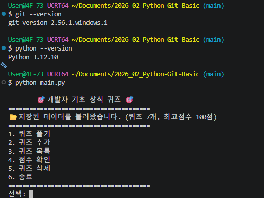
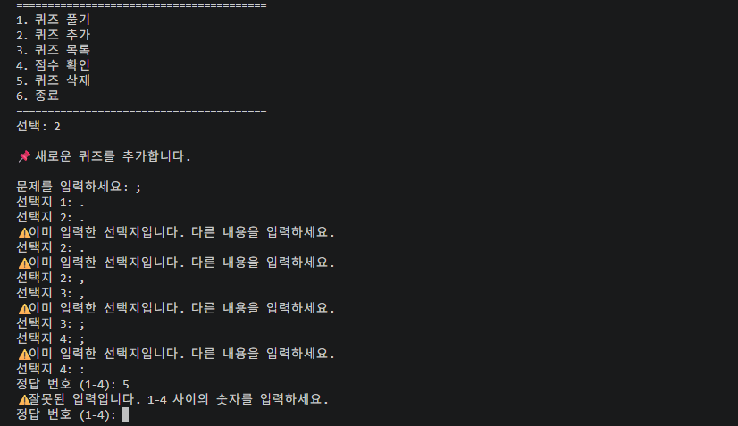
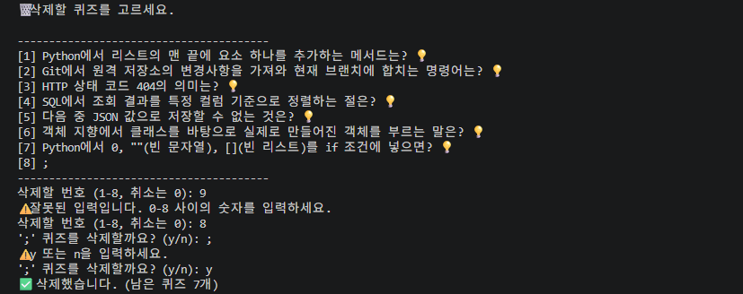
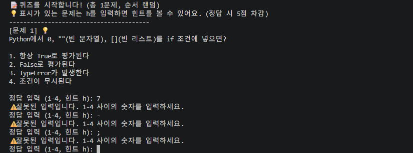
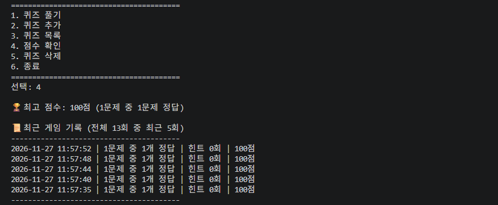

# 🎯 개발자 기초 상식 퀴즈 게임

## 프로젝트 개요

터미널에서 실행하는 객관식 퀴즈 게임입니다.
Python 기본 문법과 표준 라이브러리만 사용했고, 클래스로 역할을 나눠 구성했습니다.
퀴즈와 점수 기록은 `state.json`에 저장되어, 프로그램을 껐다 켜도 그대로 유지됩니다.

- 언어: Python 3.10 이상 (외부 라이브러리 없음)
- 사용한 표준 라이브러리: `json`, `random`, `datetime`, `pathlib`, `os`

## 퀴즈 주제와 선정 이유

**주제: 개발자 기초 상식 (Python · Git · 웹 · DB · 객체 지향)**

> 이번 과정에서 배우는 Python과 Git, 그리고 실무에서 매일 쓰는 HTTP·SQL·JSON 같은 기초 개념을 문제로 만들어 스스로 점검하고 싶었습니다. 문제를 직접 만들면서 "정확히 설명할 수 있는가"를 확인할 수 있었고, 힌트를 쓰면서 개념을 한 줄로 요약하는 연습도 되었습니다.

## 실행 방법

```bash
# 1. 저장소 복제
git clone https://github.com/yeonwoo7673/2026_02_Python-Git-Basic.git
cd <2026_02_python-git-basic>

# 2. Git 버전 확인
User@4F-73 UCRT64 ~/Documents/2026_02_Python-Git-Basic (main)
$ git --version
git version 2.56.1.windows.1

# 2. Python 버전 확인 (3.10 이상)
User@4F-73 UCRT64 ~/Documents/2026_02_Python-Git-Basic (main)
$ python --version
Python 3.12.10

# 3. 실행 (macOS/Linux에서 python이 없으면 python3)
User@4F-73 UCRT64 ~/Documents/2026_02_Python-Git-Basic (main)
$ python main.py
========================================
        🎯 개발자 기초 상식 퀴즈 🎯
========================================
📂 저장된 데이터를 불러왔습니다. (퀴즈 7개, 최고점수 100점)
========================================
1. 퀴즈 풀기
2. 퀴즈 추가
3. 퀴즈 목록
4. 점수 확인
5. 퀴즈 삭제
6. 종료
========================================
```



- 메뉴에서 번호를 입력해 기능을 고릅니다.
- 실행 중 `Ctrl+C`를 눌러도 데이터를 저장한 뒤 안전하게 종료됩니다.

## 기능 목록

### 기본 기능

| 메뉴 | 기능 | 설명 |
|---|---|---|
| 1 | 퀴즈 풀기 | 저장된 퀴즈를 출제하고 정답/오답을 알려준 뒤 결과(점수)를 표시 |
| 2 | 퀴즈 추가 | 문제, 선택지 4개, 정답 번호, (선택) 힌트를 입력받아 등록 후 저장 |
| 3 | 퀴즈 목록 | 등록된 퀴즈 목록 출력 (💡 = 힌트 있음) |
| 4 | 점수 확인 | 최고 점수와 최근 게임 기록 출력 |
| 5 | 퀴즈 삭제 | 번호로 골라 확인(y/n) 후 삭제, 파일에 반영 |
| 6 | 종료 | 저장 후 종료 |

### 보너스 기능

- **랜덤 출제**: `random.sample()`로 매번 문제 순서를 섞어 출제
- **문제 수 선택**: 풀기 전에 1~(전체 개수) 중 몇 문제를 풀지 선택
- **힌트**: 💡 표시 문제에서 `h` 입력 시 힌트 표시. 힌트를 보고 맞히면 10점 → 5점
- **퀴즈 삭제**: 메뉴 5번
- **점수 기록 히스토리**: 게임마다 날짜/시간, 푼 문제 수, 정답 수, 힌트 사용 수, 점수를 저장

### 점수 계산

- 문제당 10점, 힌트를 사용하고 맞히면 5점, 틀리면 0점
- 최종 점수 = 얻은 점수 ÷ (문제 수 × 10) × 100 (반올림, 100점 만점)
- 문제 수가 달라도 비교할 수 있도록 100점 만점으로 환산해 최고 점수와 비교합니다.

### 입력/예외 처리

- 입력 앞뒤 공백 제거 (` 1 ` → `1`)
- 빈 입력, 숫자가 아닌 입력(`abc`), 범위 밖 숫자(`9`, `0`)는 안내 후 다시 입력
- `Ctrl+C`(KeyboardInterrupt), 입력 끝(EOFError) 발생 시 저장 후 안전하게 종료
- `state.json`이 없으면 기본 퀴즈로 시작
- `state.json`이 손상되면 안내 후 `state.corrupted-날짜시간.json`으로 백업하고 기본 데이터로 복구

## 파일 구조

```text
.
├── main.py              # 실행 진입점, Ctrl+C/EOF 처리
├── game.py              # QuizGame 클래스: 메뉴, 풀기/추가/목록/점수/삭제, 저장·불러오기 흐름
├── quiz.py              # Quiz 클래스: 문제 1개 (출력, 정답 확인, dict 변환)
├── storage.py           # StateStore 클래스: state.json 읽기/쓰기, 손상 파일 백업
├── input_handler.py     # 공통 입력 검증 함수 (숫자 범위, 빈 입력, y/n)
├── default_quizzes.py   # 기본 퀴즈 7개
├── state.json           # 실행 시 자동 생성되는 데이터 파일 (.gitignore로 제외)
├── docs/
│   └── screenshots/                 # 실행 화면 캡처
│       ├── .gitkeep
│       ├── 01.directory.png         # 파일 구조
│       ├── 02.version_check.png     # Git·Python 버전 확인 및 실행
│       ├── 03.quiz_menu.png         # 메뉴 화면
│       ├── 04-1.quiz_play.png       # 퀴즈 풀기
│       ├── 04-2.quiz_exception.png  # 잘못된 입력 처리
│       ├── 05.quiz_add.png          # 퀴즈 추가
│       ├── 06.quiz_delete.png       # 퀴즈 삭제
│       ├── 07.quiz_score.png        # 점수 확인
│       ├── 08.quiz_list.png         # 퀴즈 목록
│       └── 09.git_log.png           # Git 커밋 기록
├── .gitignore
└── README.md
```

> `__pycache__/`는 Python이 실행할 때 자동으로 만드는 캐시 폴더라서 `.gitignore`로 제외했습니다.


### 클래스별 역할

| 클래스 | 책임 |
|---|---|
| `Quiz` | 퀴즈 1개의 데이터와 검증, 화면 출력, 정답 확인 |
| `QuizGame` | 게임 전체 상태(퀴즈 목록, 최고 점수, 기록)와 메뉴 흐름 |
| `StateStore` | 파일 입출력만 담당 (게임 로직은 모름) |

## 데이터 파일 설명 (`state.json`)

- **경로**: 프로젝트 루트의 `state.json` (`main.py`와 같은 폴더, 어디서 실행해도 같은 위치)
- **인코딩**: UTF-8 (한글이 그대로 보이도록 `ensure_ascii=False`)
- **역할**: 퀴즈 목록, 최고 점수, 게임 기록을 저장해 재실행 후에도 유지
- **생성 시점**: 첫 실행 시 자동 생성되고, 퀴즈 추가/삭제, 게임 종료, 프로그램 종료 때마다 저장
- **저장 방식**: 임시 파일(`state.json.tmp`)에 먼저 쓴 뒤 교체하여, 저장 도중 문제가 생겨도 기존 파일이 깨지지 않음
- **Git 관리**: 개인 플레이 기록이므로 `.gitignore`에 넣어 저장소에는 올리지 않음

### 스키마

```json
{
    "quizzes": [
        {
            "question": "Python에서 리스트의 맨 끝에 요소 하나를 추가하는 메서드는?",
            "choices": ["append()", "insert()", "extend()", "add()"],
            "answer": 1,
            "hint": "'덧붙이다'라는 뜻의 영어 단어예요."
        }
    ],
    "best_score": 80,
    "best_record": {
        "played_at": "2026-11-25 19:40:00",
        "total": 5,
        "correct": 4,
        "hints_used": 0,
        "score": 80
    },
    "history": [
        {
            "played_at": "2026-11-25 19:40:00",
            "total": 5,
            "correct": 4,
            "hints_used": 0,
            "score": 80
        }
    ]
}
```

| 키 | 타입 | 설명 |
|---|---|---|
| `quizzes` | list | 퀴즈 목록 (필수) |
| `quizzes[].question` | str | 문제 |
| `quizzes[].choices` | list[str] | 선택지 4개 |
| `quizzes[].answer` | int | 정답 번호 (1~4) |
| `quizzes[].hint` | str | 힌트 (없으면 빈 문자열) |
| `best_score` | int \| null | 최고 점수 (0~100), 아직 안 풀었으면 `null` |
| `best_record` | object \| null | 최고 점수를 낸 게임의 기록 |
| `history` | list | 모든 게임 기록 (`played_at`, `total`, `correct`, `hints_used`, `score`) |

`best_record`, `history`, `hint`가 없는 예전 형식의 파일도 그대로 불러올 수 있습니다.

## Git 커밋 기록

`git log --oneline --graph` 결과입니다. `feature/play`, `feature/bonus` 브랜치에서 기능을 개발한 뒤 `main`에 병합했습니다.

```bash
* fbdc175 (HEAD -> main, origin/main, origin/HEAD) Docs: clone 실습용 README.md 문구 추가
* ea4280b Docs: README.md 작성 (개요, 실행 방법, 기능, 파일 구조, state.json 설명
*   c7e82ea Merge: feature/bonus branch 병합 (보너스 기능)
|\  
| * 31d278e (origin/feature/bonus, feature/bonus) Feat: 게임 기록 히스토리(날짜/문제 수/점수) 저장 및 조회
| * bf76d50 Feat: 퀴즈 삭제 기능 추가 (확인 후 삭제, 파일 반영)
| * 9145e77 Feat: Quiz Hint 속성 추가, Hint 사용 시 점수 차감
| * 711b9eb Feat: 풀이 문제 수 선택 기능 추가
| * 6f66f33 Feat: 퀴즈 출제 순서 랜덤화 (random.sample)
|/  
* 5348e26 Feat: state.json 저장/불러오기 및 손상 파일 백업·복구 구현
* e2030c9 Refactor: QuizGame 메뉴를 이름, 메서드 목록으로 정리, 목록 출력 분리
* 6f7fcbb Feat: 최고 점수 비교/갱신 및 점수 확인 기능 구현
* f3cba66 Feat: 퀴즈 목록 보기 기능 구현
* 64c0793 Feat: 퀴즈 추가 기능 구현 (빈 입력/중복 선택지/정답 범위 검사)
*   310cf5d Merge: feature/play 브랜치 병합 (퀴즈 풀기)
|\  
| * 2fbde9c (origin/feature/play, feature/play) Feat: 퀴즈 출제, 정답/오답 판정 및 결과 표시 구현
|/  
* 89cdfed Feat: 기본 퀴즈 데이터 7개 작성
*   9c3bae2 Merge branch 'main' of https://github.com/yeonwoo7673/2026_02_Python-Git-Basic
|\  
| * 8842a79 Feat: game.py edit
* | fc08cd0 Feat: Quiz class 구현 (문제 출력, 정답 확인, dict 변환)
|/  
*   4034620 Feat: 메뉴 출력/선택/종료 및 공통 입력 예외 처리 구현
|\  
| * 7d7a35a [docs]:261125_mission02_start
| * e8d277e [docs]:261125_mission02_start
| * 19101cf Initial commit
* 5e5baa5 Feat: 메뉴 출력/선택/종료 및 공통 입력 예외 처리 구현
* c1c2946 Chore: 프로젝트 초기 설정 (.gitignore, README.md 생성)
```


## 실행 화면

| 메뉴 | 퀴즈 풀기 |
|---|---|
|  |  |

| 퀴즈 추가 | 퀴즈 삭제 |
|---|---|
|  |  |

| 예외 처리 | 점수 확인 |
|---|---|
|  |  |

| 퀴즈 목록 |
|---|---|
|  |